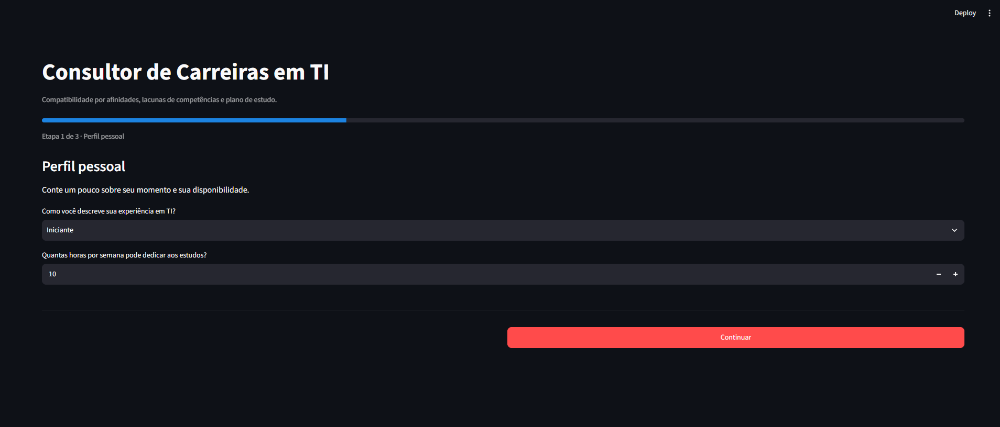
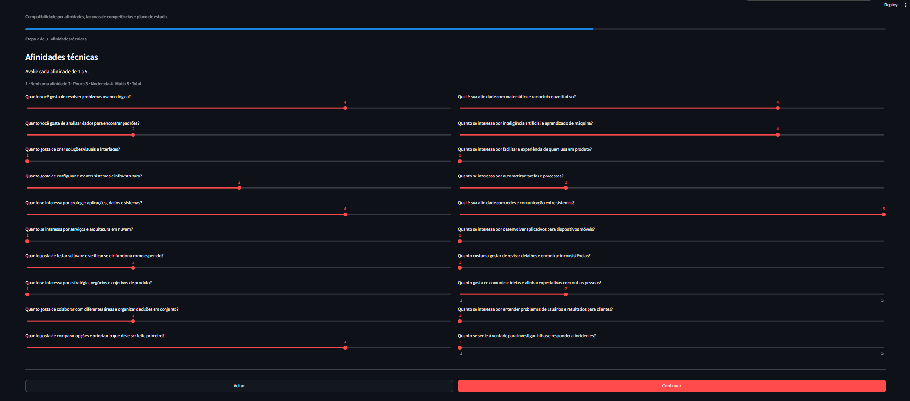
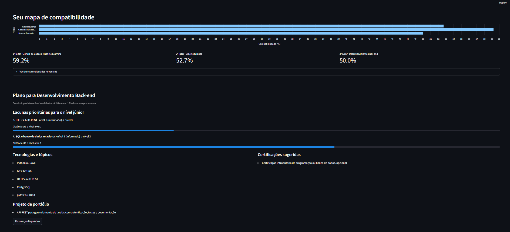

# Consultor de Carreiras em TI

Aplicação web que ajuda estudantes e pessoas em transição de carreira a explorar caminhos profissionais em tecnologia. Em vez de escolher uma única profissão com base em respostas de “sim ou não”, o sistema considera afinidades, objetivos e conhecimentos que a própria pessoa avalia.

> É uma ferramenta de orientação e autoconhecimento. As compatibilidades são estimativas para ajudar na reflexão, não uma avaliação profissional nem uma garantia de emprego.

## Como funciona

O diagnóstico é feito em três etapas:

1. **Perfil pessoal:** informe sua experiência em TI e quantas horas por semana pode estudar.
2. **Afinidades técnicas:** avalie de 1 a 5 seu interesse por temas como dados, design, infraestrutura, segurança e comunicação.
3. **Objetivos de carreira:** indique o tipo de trabalho que procura, seu prazo e seu nível atual nas habilidades da trilha escolhida.

Ao concluir, você verá:

- As três trilhas mais compatíveis, com percentuais e fatores considerados;
- Uma comparação das habilidades avaliadas com o nível definido como Júnior;
- Tecnologias priorizadas conforme as lacunas identificadas;
- Sugestões de certificação e projeto de portfólio;
- Uma orientação de ritmo baseada no prazo e nas horas de estudo informados.

As imagens abaixo mostram o preenchimento do perfil, a avaliação de afinidades e um exemplo de resultado:







## Trilhas avaliadas

O sistema compara o perfil com dez áreas:

| Trilha | Exemplos de interesses relacionados |
|---|---|
| Back-end | Lógica, APIs e serviços |
| Front-end e UX | Interfaces, design e experiência de uso |
| Ciência de Dados | Matemática, análise e aprendizado de máquina |
| Engenharia de Dados | Pipelines, bancos de dados e automação |
| Cibersegurança | Segurança, redes e resposta a incidentes |
| DevOps e SRE | Infraestrutura, automação e confiabilidade |
| Cloud Architecture | Nuvem, redes e arquitetura de sistemas |
| Mobile | Aplicativos e interfaces para dispositivos móveis |
| QA | Testes, qualidade e atenção aos detalhes |
| Product Management | Usuários, comunicação e priorização |

## Como a recomendação é calculada

As afinidades são combinadas com pesos específicos de cada trilha. A preferência de trabalho também pode influenciar o ranking; quando a pessoa escolhe “Ainda estou explorando”, o ranking considera as afinidades sem esse ajuste. Algumas respostas podem aplicar penalidades configuradas para determinadas trilhas.

O percentual expressa compatibilidade relativa com as respostas fornecidas: não é uma probabilidade de contratação. O resultado serve como ponto de partida para comparar possibilidades.

Para montar o plano, o sistema compara as habilidades informadas com o nível Júnior definido na base de conhecimento. Habilidades não avaliadas são tratadas como iniciais. As tecnologias ligadas às lacunas são priorizadas, e o prazo escolhido e a disponibilidade semanal ajudam a contextualizar o ritmo sugerido.

## Executar localmente

É necessário ter Python instalado.

No PowerShell:

```powershell
py -3 -m venv .venv
.\.venv\Scripts\Activate.ps1
pip install -r requirements.txt
streamlit run app.py
```

No macOS ou Linux:

```bash
python3 -m venv .venv
source .venv/bin/activate
pip install -r requirements.txt
streamlit run app.py
```

O Streamlit abrirá a aplicação no navegador, normalmente em `http://localhost:8501`.

## Testes

Com o ambiente virtual ativado, execute:

```bash
python -m unittest discover -s tests -v
```

Os testes cobrem o ranking ponderado, perfis ambíguos, casos-limite e a geração de lacunas e recomendações.

## Base de conhecimento

As perguntas, os pesos, as penalidades, as habilidades de nível Júnior e as recomendações ficam em [`regras_carreiras.json`](./regras_carreiras.json). Assim, é possível ajustar o conteúdo das trilhas sem misturar essas definições ao código do motor. A lógica de pontuação fica em `engine/engine.py`, e a análise de lacunas e o plano de estudos em `engine/roadmap.py`.
