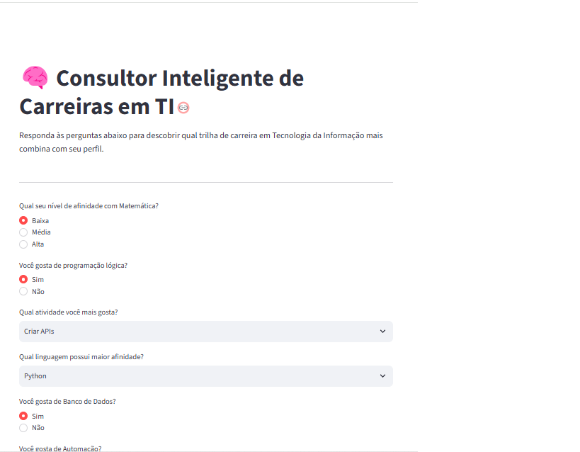
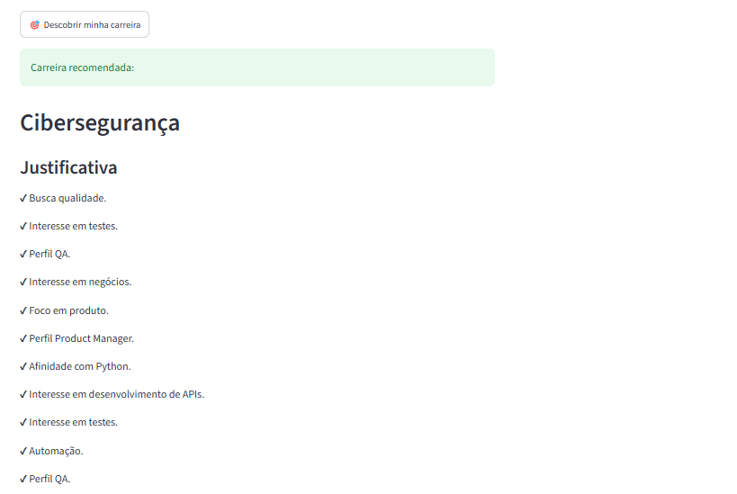

# 🧠 Consultor Inteligente de Carreiras em TI

Sistema Especialista baseado em regras desenvolvido em Python, com o objetivo de auxiliar estudantes e profissionais da área de Tecnologia da Informação na escolha de uma trilha de carreira compatível com seu perfil.

O sistema realiza uma entrevista com o usuário através de perguntas sobre afinidades, preferências profissionais, conhecimentos prévios e objetivos de atuação. A partir das respostas coletadas, um motor de inferência baseado em regras analisa os fatos e recomenda a carreira mais adequada.

---

# 🖥️ Tela de Resultado Esperado 






---
# 🎯 Objetivo

Desenvolver um Sistema Especialista capaz de identificar a trilha de carreira em TI mais compatível com o perfil do usuário utilizando:

- Engenharia de Conhecimento;
- Base de fatos;
- Regras de inferência;
- Encadeamento para frente;
- Interface Web interativa.

O sistema busca simular o processo de orientação profissional realizado por um especialista humano.

---

# 🚀 Tecnologias Utilizadas

- **Python**  
  Linguagem principal utilizada no desenvolvimento do sistema.

- **Experta**  
  Biblioteca utilizada para criação do motor de inferência baseado em regras.

- **Streamlit**  
  Framework utilizado para construção da interface web.

- **Git/GitHub**  
  Controle de versão e armazenamento do projeto.

---

# 📂 Estrutura do Projeto

```
consultor-carreiras-ti/
│
├── app.py                     # Interface Web utilizando Streamlit
├── requirements.txt            # Dependências do projeto
├── decision_matrix.md          # Matriz de decisão das regras
├── knowledge_base.md           # Documentação da base de conhecimento
├── README.md                   # Documentação do projeto
│
├── engine/                     # Núcleo do sistema especialista
│   │
│   ├── __init__.py             # Compatibilidade das dependências do motor
│   ├── facts.py                # Definição dos fatos do usuário
│   ├── inference.py            # Motor de inferência utilizando Experta
│   ├── questions.py            # Perguntas da entrevista
│   └── rules.py                # Regras especialistas do sistema
│
├── models/
│   └── careers.py              # Definição das trilhas de carreira
│
└── tests/
    └── test_rules.py           # Testes das recomendações e perguntas
```

---

# 🧠 Funcionamento do Sistema

O sistema funciona utilizando uma arquitetura de Sistema Especialista baseada em regras.

O fluxo de funcionamento ocorre da seguinte forma:

```
Usuário
   |
   ↓
Entrevista de Perfil
   |
   ↓
Criação dos Fatos
   |
   ↓
Motor de Inferência (Experta)
   |
   ↓
Aplicação das Regras
   |
   ↓
Recomendação da Carreira
```

Durante a entrevista, o sistema coleta informações como:

- Afinidade matemática e estatística;
- Preferências de atividades;
- Linguagens ou ferramentas conhecidas;
- Interesse em áreas específicas;
- Tipo de entrega de valor desejada.

Após a coleta das respostas, essas informações são transformadas em fatos e analisadas pelo motor de inferência.

---

# 🎯 Trilhas de Carreira Disponíveis

O sistema pode recomendar uma das 10 trilhas:

## 1. Desenvolvimento Back-end

Foco em:

- Construção de APIs;
- Regras de negócio;
- Desenvolvimento de servidores;
- Banco de dados.

---

## 2. Desenvolvimento Front-end & UI/UX

Foco em:

- Interfaces web;
- Experiência do usuário;
- Design de aplicações;
- Frameworks modernos.

---

## 3. Ciência de Dados e Machine Learning

Foco em:

- Inteligência Artificial;
- Estatística;
- Modelos preditivos;
- Análise de dados.

---

## 4. Engenharia de Dados

Foco em:

- Arquitetura de dados;
- Pipelines ETL/ELT;
- Processamento de grandes volumes de dados;
- Data Lakes.

---

## 5. Cibersegurança

Foco em:

- Segurança digital;
- Redes;
- Vulnerabilidades;
- Proteção de sistemas.

---

## 6. DevOps & SRE

Foco em:

- Automação;
- Integração contínua (CI/CD);
- Contêineres;
- Infraestrutura.

---

## 7. Computação em Nuvem

Foco em:

- Arquitetura Cloud;
- AWS, Azure e GCP;
- Escalabilidade;
- Gestão de infraestrutura.

---

## 8. Desenvolvimento Mobile

Foco em:

- Aplicativos móveis;
- Desenvolvimento Android/iOS;
- Flutter;
- React Native.

---

## 9. Engenharia de Qualidade e Testes (QA)

Foco em:

- Testes automatizados;
- Qualidade de software;
- Confiabilidade;
- Processos de validação.

---

## 10. Gestão de Produtos

Foco em:

- Estratégia de produto;
- Metodologias ágeis;
- Comunicação entre negócio e desenvolvimento;
- Priorização de funcionalidades.

---

# ⚙️ Instalação

## 1. Clonar o repositório

```bash
git clone https://github.com/ramosBlk/consultor-carreiras-ti.git
```

Acesse a pasta:

```bash
cd consultor-carreiras-ti
```

---

## 2. Criar ambiente virtual

```bash
python -m venv .venv
```

Ativar ambiente virtual:

Windows PowerShell:

```powershell
.\.venv\Scripts\Activate.ps1
```

---

## 3. Instalar dependências

```bash
pip install -r requirements.txt
```

---

# ▶️ Executando o Sistema

Com o ambiente virtual ativado:

```bash
streamlit run app.py
```

O sistema será aberto automaticamente no navegador:

```
http://localhost:8501
```

---

# 📋 Motor de Inferência

O sistema utiliza regras do tipo:

```
SE condição
ENTÃO recomendação
```

Exemplo:

```
SE usuário possui afinidade com Python
E gosta de criar APIs

ENTÃO recomendar Desenvolvimento Back-end
```

Cada regra possui uma justificativa associada, permitindo transparência na decisão.

---

# 🧪 Validação com Personas

Para executar os testes automatizados com as dependências instaladas:

```bash
python -m unittest discover -s tests
```

Os testes cobrem perfis representativos das dez trilhas, um perfil sem
recomendação e a consistência das opções da entrevista.

---

O sistema será validado utilizando diferentes perfis de usuários.

## Persona 1 - Perfil Analítico

Características:

- Alta afinidade matemática;
- Interesse em dados;
- Interesse em inteligência artificial.

Resultado esperado:

```
Ciência de Dados e Machine Learning
```

---

## Persona 2 - Perfil Desenvolvimento

Características:

- Interesse em programação;
- Gosta de lógica;
- Interesse em APIs.

Resultado esperado:

```
Desenvolvimento Back-end
```

---

## Persona 3 - Perfil Infraestrutura

Características:

- Interesse em servidores;
- Redes;
- Cloud;
- Automação.

Resultado esperado:

```
DevOps & SRE
ou
Computação em Nuvem
```

---

## Persona 4 - Perfil Negócios

Características:

- Interesse em produto;
- Comunicação;
- Estratégia.

Resultado esperado:

```
Gestão de Produtos
```

---

# 📚 Engenharia de Conhecimento

O projeto possui documentos auxiliares:

## decision_matrix.md

Contém a matriz de decisão utilizada para estruturar como as respostas do usuário ativam as regras do sistema.

## knowledge_base.md

Contém a organização do conhecimento especialista utilizado pelo motor de inferência.

---

# 👨‍💻 Autor

**Pedro Henrique Ramos de Carvalho**

Projeto acadêmico desenvolvido para a disciplina de Inteligência Artificial.

**Centro Universitário Presidente Antônio Carlos - UNIPAC Barbacena**

# 🤖 Uso de Inteligência Artificial como Apoio no Desenvolvimento

Durante o desenvolvimento deste projeto, foi utilizada a ferramenta **ChatGPT** como recurso de apoio para auxiliar na organização das ideias, estruturação do projeto.

A utilização da inteligência artificial teve como objetivo auxiliar o processo de aprendizagem e desenvolvimento, enquanto todas as decisões de implementação, organização do código, criação das regras do sistema especialista e validação do funcionamento foram realizadas durante a construção do projeto.

A ferramenta foi utilizada como um suporte semelhante a uma consulta técnica, contribuindo para a evolução do projeto e para o entendimento das tecnologias utilizadas.
